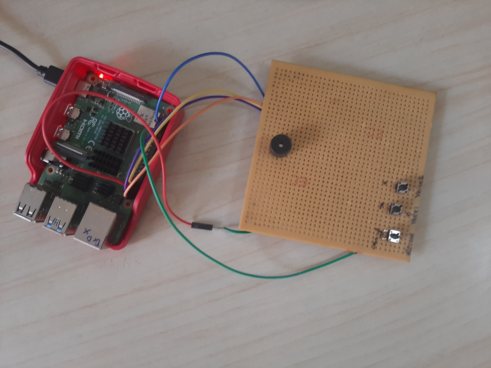

# Selective Speech Separation on Raspberry Pi using DPRNN-TasNet

- This project implements a **selective speech separation system** on a **Raspberry Pi 4B** using the pre-trained **DPRNN-TasNet** model from the [Asteroid toolkit](https://github.com/asteroid-team/asteroid). 
- It shows **Edge AI** in practice: a pre-trained deep learning model runs on a low-power, affordable board and separates mixed audio into individual speakers.

---

## Overview

Speech separation splits a single-channel recording of overlapping speech into one signal per speaker. Here, one button records, the Pi separates the recording into two speakers as soon as the button is released, and the other two buttons let you choose which voice to hear. The separation runs after the recording ends, not live while people speak.

<p align="center">
  
  <br>
  <em>The Raspberry Pi 4B and the three push buttons: Record, Voice 1 and Voice 2</em>
</p>

---

## Features

-  Record mixed speech using a microphone
-  Separate the recording into two speakers using DPRNN-TasNet
-  Playback separated sources through physical push buttons
-  Runs entirely on Raspberry Pi (Edge Computing)
-  Uses `torchaudio`, `asteroid`, and `PyTorch` for audio and model processing

---

## Hardware Requirements

- Raspberry Pi 4B (4GB recommended)
- USB microphone or supported audio input device
- 3x Push Buttons (GPIO-connected)
- Speaker or 3.5mm audio output device

---

## Software Stack

- Python 3.7+
- PyTorch
- torchaudio
- asteroid
- RPi.GPIO
- arecord / aplay (ALSA)
- RealVNC (optional for GUI access)
- PuTTY (optional for SSH access)

---

## Setup Instructions

1. **Clone the Repository**
   ```bash
   git clone https://github.com/AshutoshBhate/ML_Projects.git
   cd ML_Projects/SelectiveSpeechSeparation_DPRNN
   ```

2. **Install Dependencies**
   ```bash
   pip install torch torchaudio asteroid RPi.GPIO
   ```

3. **Enable Audio & GPIO Support**
   - Recording and playback use the `pulse` audio device (`arecord -D pulse`, `aplay -D pulse`), which Raspberry Pi OS with desktop provides.
   - Connect each push button between its GPIO pin (16, 20 or 21) and ground. The script turns on the Pi's internal pull-up resistors, so no external resistors are needed.

4. **Run**
   ```bash
   python DPRNN_TasNet.py
   ```
   The first run downloads the pre-trained model, so it needs an internet connection.

## How it works
- BP1 (GPIO 16) – Press and hold to start recording. Release to stop and trigger separation.
- BP2 (GPIO 20) – Press to play the first separated source.
- BP3 (GPIO 21) – Press to play the second separated source.

  Recording is done using arecord (16 kHz, mono) and played using aplay. When the recording stops, the audio is resampled to 8 kHz and separated by the pre-trained DPRNN-TasNet model `mpariente/DPRNNTasNet-ks2_WHAM_sepclean` (2 speakers, trained on the WHAM! dataset). The two separated sources are saved as `Source_1.wav` and `Source_2.wav`.

## File Structure
```bash
├── DPRNN_TasNet.py         # Main application script
├── DPRNN_Raspi_Photo.jpg   # Photo of the setup
└── README.md               # Project documentation

Created when the script runs:
├── MixedSpeech.wav         # Recorded mixed input
├── Source_1.wav            # Output audio source 1
└── Source_2.wav            # Output audio source 2
```

## Future Improvements

- Separate the audio while recording (streaming) instead of after the recording ends
- Add LED indicators for recording/playback states
- Support multi-speaker separation (>2)
- Optimize model inference for faster separation
- Integrate with a small display for UI feedback
